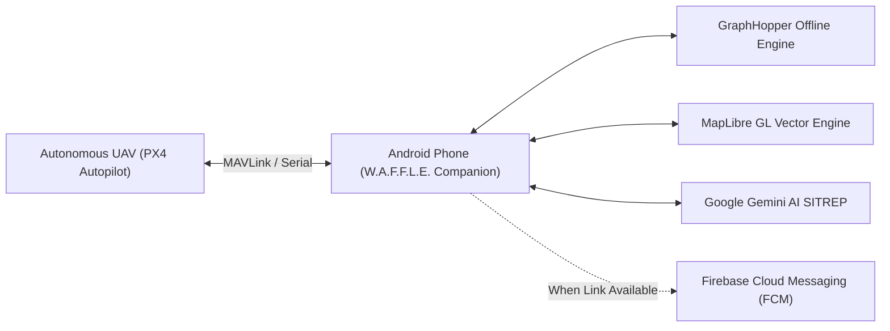
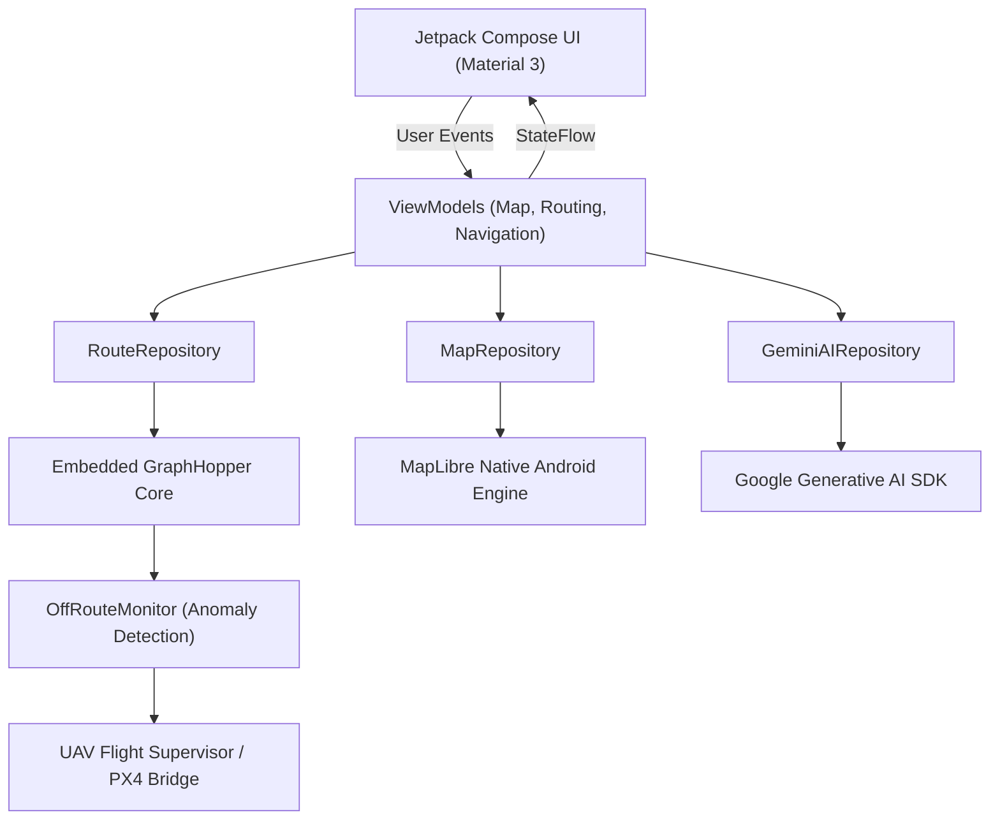

<p align="center">
  
</p>

<h1 align="center">W.A.F.F.L.E. — Wireless Autonomous Flying Fleet for Life Emergencies</h1>

<p align="center">
  <strong>Mission-critical Android companion flight station and zero-connectivity navigation console for emergency response UAVs.</strong>
</p>

<p align="center">
  <a href="https://kotlinlang.org"></a>
  <a href="https://developer.android.com/jetpack/compose"></a>
  <a href="https://developer.android.com"></a>
  <a href="https://maplibre.org"></a>
  
</p>

<p align="center">
  
  
  
  
  
</p>

---

## 📑 Table Of Contents

- [What W.A.F.F.L.E. Is](#what-waffle-is)
- [Mission & Design Principles](#mission--design-principles)
- [Feature Matrix](#feature-matrix)
- [System Architecture](#system-architecture)
- [Zero-Connectivity Routing Engine](#zero-connectivity-routing-engine)
- [PX4 Autopilot & Companion Telemetry](#px4-autopilot--companion-telemetry)
- [Gemini Multimodal Disaster Intelligence](#gemini-multimodal-disaster-intelligence)
- [Repository Layout](#repository-layout)
- [Build And Run](#build-and-run)
- [Brand Identity & Heritage](#brand-identity--heritage)
- [License](#license)

---

## 🚁 What W.A.F.F.L.E. Is

**W.A.F.F.L.E.** (*Wireless Autonomous Flying Fleet for Life Emergencies*) is a ruggedized, offline-first Android application designed to bridge heavy autonomous flight logic and field ground operators in high-consequence disaster zones.

When natural catastrophes (floods, earthquakes, wildfires) strike, cellular towers and Wi-Fi networks are consistently the first municipal systems to fail. W.A.F.F.L.E. transforms a commodity Android device into a field navigation and emergency-awareness console, coupling local vector map rendering, embedded graph routing, hazard avoidance, alerts, and optional online services without requiring an active internet connection.

> **Preview status:** the map, offline/online routing, alerts, search, navigation, Test Mode, floating map and vehicle UI are implemented. The PX4/MAVLink/DJI autopilot bridge and autonomous-flight claims below are roadmap items, not part of the current APK. See [PRIVACY.md](PRIVACY.md) and [ATTRIBUTIONS.md](ATTRIBUTIONS.md).



---

## 🎯 Mission & Design Principles

- **Zero-Internet Guarantee:** All primary navigation, geocoding, turn-by-turn guidance, and perimeter mapping function with zero network dependencies.
- **Companion Hardware Synergy:** Built to act either as a handheld ground operator interface or mounted directly to drone airframes as an onboard Android companion computer running flight supervisory loops over PX4/DJI SDK.
- **Low-Latency Situational Awareness:** Renders 60 FPS vector map layers with live disaster-zone boundary polygons (flood waterlines, wildfire perimeters, building collapse sectors).
- **Graceful Connectivity Recovery:** Caches all field telemetry, mission waypoints, and incident logs locally via Jetpack DataStore and SQLite, opportunistically synchronizing via Firebase FCM when uplinks are restored.

---

## 📊 Feature Matrix

| Subsystem | Capability | Technical Details |
| :--- | :--- | :--- |
| **Offline Mapping** | MapLibre Native Vector GL | High-resolution vector tile rendering, dynamic camera bearing, pitch control, and custom hazard overlays. |
| **Autonomous Routing** | GraphHopper Engine | On-device graph routing, dynamic rerouting, obstacle avoidance, and real-time `OffRouteMonitor` alerts. |
| **Avionics & Telemetry** | Companion Drone Controller | Telemetry bridging over MAVLink & DJI Mobile SDK, live coordinate tracking, and mission waypoint streaming. |
| **Disaster AI** | Google Gemini Integration | Natural language disaster prompt parsing, emergency priority extraction, and automated SITREP generation. |
| **Alert Dispatching** | Firebase Cloud Messaging (FCM) | Low-latency broadcast channels for immediate disaster sector hazard warnings and fleet updates. |
| **Foreground Resilience** | Persistent Location Service | Continuous coordinate broadcast service immune to Android OS background memory trimming. |

---

## 🧠 System Architecture

W.A.F.F.L.E. strictly follows modern Android Architecture Components (MVVM) with unidirectional data flow (UDF) powered by Kotlin Coroutines and StateFlow:



---

## 🧭 Zero-Connectivity Routing Engine

The core navigation pipeline is driven by an optimized, on-device GraphHopper engine that parses local road networks and terrain constraints directly from flash storage:

1. **Local Graph Loading:** Bypasses external HTTP routing APIs, evaluating path cost matrices directly on CPU.
2. **OffRouteMonitor:** Continuously projects real-time GPS / UAV ground coordinates against the active polyline. If deviations exceed tolerance ($\Delta > \epsilon$), an immediate course recalculation triggers within $< 15\text{ ms}$.
3. **Multi-Modal Profile Support:** Calculates routing vectors for emergency ground response vehicles, pedestrian search parties, and aerial waypoint projections.

---

## 🤖 Gemini Multimodal Disaster Intelligence

W.A.F.F.L.E. embeds the Google Gemini Generative AI SDK to translate chaotic field reports into structured mission data:
* **Operator Voice/Text Prompts:** Automatically parses ambiguous inputs (*"Bridge on 4th Ave collapsed, floodwater approaching sector B"*) into geo-located hazard markers and route avoidance polygons.
* **Triage Prioritization:** Generates structured situation summaries (SITREPs) categorized by threat urgency, structural integrity, and survivor evacuation corridors.

---

## 📦 Repository Layout

```text
Waffle/
├── app/
│   ├── src/main/java/com/noobdev/waffle/
│   │   ├── core/
│   │   │   ├── navigation/        # OffRouteMonitor, waypoint guidance, and geofencing
│   │   │   ├── routing/           # GraphHopper offline engine and route repositories
│   │   │   └── data/              # DataStore preferences, models, and local databases
│   │   ├── feature/
│   │   │   ├── map/               # MapLibre GL compose screens, layers, and gesture hooks
│   │   │   ├── navigation/        # Turn-by-turn navigation HUD and live instructions
│   │   │   └── ai/                # Gemini prompt parsing and disaster intelligence
│   │   └── ui/theme/              # Material Design 3 palettes, typography, and components
│   └── build.gradle.kts           # Version catalog dependencies and R8 rules
├── assets/
│   ├── waffle-readme-header.png   # High-resolution project header banner
│   └── waffle-readme-header.svg   # Scalable vector graphics source
├── branding/
│   ├── mark.svg                   # Original quadcopter-waffle vector mark
│   ├── icon.svg                   # Android adaptive launcher icon artwork
│   └── icon-512.png               # High-res rendered mark
└── gradle/libs.versions.toml      # Dependency versions catalog
```

---

## 🛠️ Build And Run

### Prerequisites
- **JDK:** OpenJDK 17 or 21
- **Android SDK:** Compile SDK 36, Min SDK 24 (Android 7.0+)
- **Build Tool:** Gradle 8.13 wrapper (`./gradlew`)

```bash
# Clone the repository
git clone https://github.com/AhmadHasssan9181/Waffle.git
cd Waffle

# Build Debug APK
./gradlew assembleDebug

# Run Unit Tests
./gradlew testDebugUnitTest

# Install directly to connected device
adb install -r app/build/outputs/apk/debug/app-debug.apk
```

---

## 🎨 Brand Identity & Heritage

The **W.A.F.F.L.E.** brand identity combines technical avionics with playful resilience:
* **The Mark:** A bespoke quadcopter whose four rotors are cast in toasted golden waffle grids with sky-blue aerodynamic propellers and an emergency telemetry amber fuselage.
* **Vector Heritage:** Master artwork is maintained in [`branding/mark.svg`](branding/mark.svg) and [`branding/icon.svg`](branding/icon.svg), generated with native vector drop-shadows and geometric precision.

---

## 📄 License

```text
Copyright (c) 2026 Ahmad Hassan.
Licensed under the MIT License.
```

---

<p align="center">
  Crafted by <a href="https://github.com/AhmadHasssan9181">Ahmad Hassan</a> • Built for Hardware, Autonomous Flight & Field Resilience
</p>
