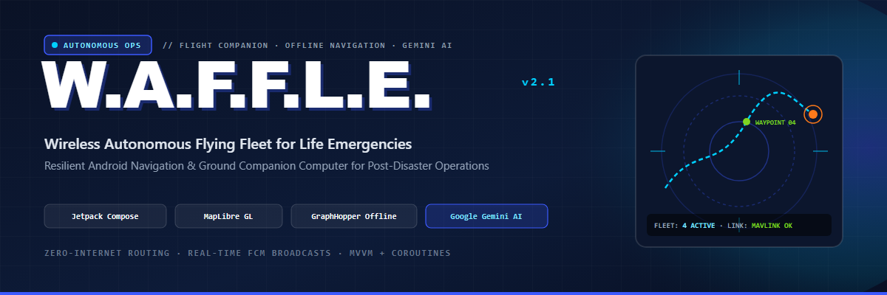
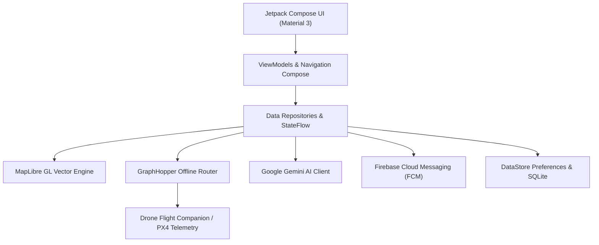

<p align="center">
  
</p>

<h1 align="center">🚁 W.A.F.F.L.E. — Wireless Autonomous Flying Fleet for Life Emergencies</h1>

<p align="center">
  <strong>Mission-critical Android flight companion and offline navigation station for emergency response UAVs.</strong>
</p>

<p align="center">
  <a href="https://kotlinlang.org"></a>
  <a href="https://developer.android.com/jetpack/compose"></a>
  <a href="https://developer.android.com"></a>
  <a href="https://maplibre.org"></a>
  
</p>

<p align="center">
  
  
  
  
</p>

---

## ⚡ Overview

During catastrophic flood, fire, or earthquake events, terrestrial cell towers and Wi-Fi networks are frequently the first infrastructure to collapse. First responders and autonomous UAV teams cannot rely on cloud APIs for navigation, telemetry routing, or map tile rendering.

**W.A.F.F.L.E.** transforms an Android smartphone into a rugged, zero-internet companion flight computer and disaster-zone navigation console:
* **Offline-First Vector Mapping:** High-performance local map rendering via **MapLibre GL** with pre-cached vector tiles.
* **Autonomous Turn-by-Turn Offline Routing:** Embedded **GraphHopper** engine computing optimal paths through disaster sectors without internet access.
* **Intelligent Disaster Telemetry:** Onboard integration with **Google Gemini** for multimodal disaster situation reports and natural-language query resolution.
* **Emergency Alert Broadcasting:** Low-latency push notifications via **Firebase Cloud Messaging (FCM)** for immediate perimeter hazard broadcasts.
* **Persistent Geofenced Tracking:** Foreground background location services providing continuous coordinate tracking and off-route detection.

---

## 🧠 System Architecture



---

## 🚀 Key Modules & Capabilities

### 1. Vector Mapping & Situational Awareness
* Fully dynamic vector map rendering using **MapLibre GL**.
* Custom disaster layer overlays: flood extents, fire perimeters, and safe landing zones.
* Smooth 60 FPS gesture control, camera tilting, and bearing lock.

### 2. Zero-Connectivity Routing
* On-device road network routing powered by an embedded GraphHopper core.
* Dynamic rerouting and off-route anomaly alerts (`OffRouteMonitor`).
* Supports custom vehicle profiles (pedestrian, emergency response truck, UAV ground waypoint projection).

### 3. Smart AI Dispatch (Google Gemini)
* Real-time analysis of emergency prompt data directly from field operators.
* Automated extraction of situational priorities, hazard levels, and recommended rally points.

### 4. Background Resilience
* Foreground Android service ensuring continuous location broadcasts even when the screen is locked or memory is constrained.
* Thread-safe asynchronous data pipelines built on Kotlin Coroutines and StateFlow.

---

## 🛠️ Tech Stack & Dependencies

| Layer | Technologies |
| :--- | :--- |
| **Language & Tooling** | Kotlin 2.1.20, Gradle Version Catalogs (`libs.versions.toml`), Android Studio Ladybug+ |
| **User Interface** | Jetpack Compose, Material 3, AndroidX Navigation Compose |
| **Mapping & GIS** | MapLibre Native SDK, GraphHopper Routing Engine |
| **Artificial Intelligence** | Google Gemini Generative AI SDK |
| **Networking & Push** | Retrofit 2, OkHttp 3, Firebase Cloud Messaging (FCM) |
| **Local Persistence** | Jetpack DataStore Preferences, Local SQLite Caching |

---

## 📦 Building & Running

### Prerequisites
* Android Studio (latest release)
* JDK 17+
* Android SDK Platform 35 / Min SDK 26

### Quickstart
```bash
git clone https://github.com/AhmadHasssan9181/Waffle.git
cd Waffle
./gradlew assembleDebug
```

---

<p align="center">
  Crafted by <a href="https://github.com/AhmadHasssan9181">Ahmad Hassan</a> • Designed for Real Hardware, Autonomous Systems & Field Resilience
</p>
