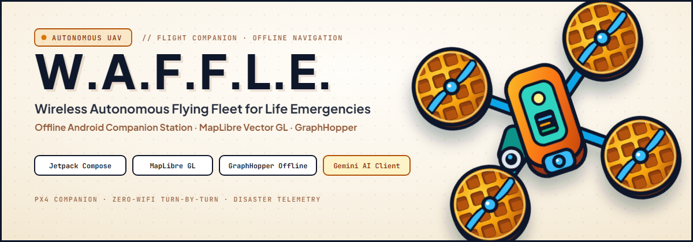
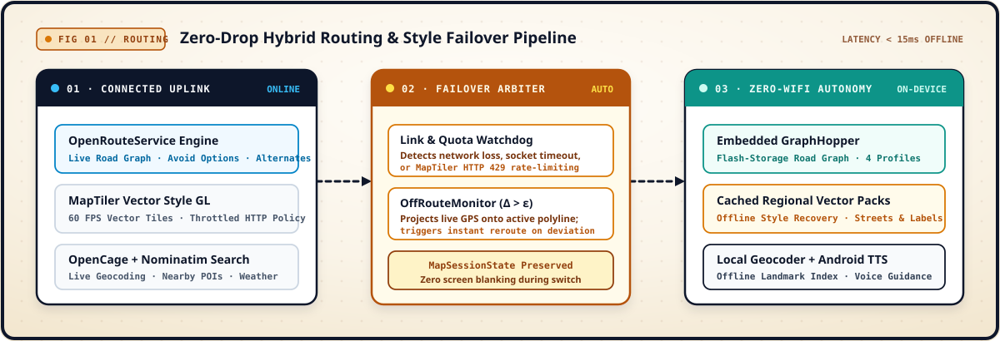
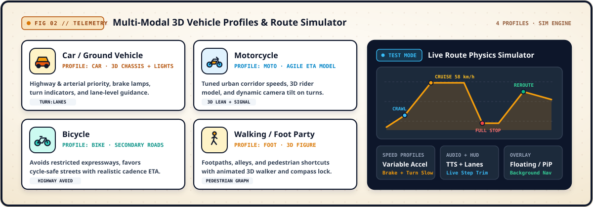
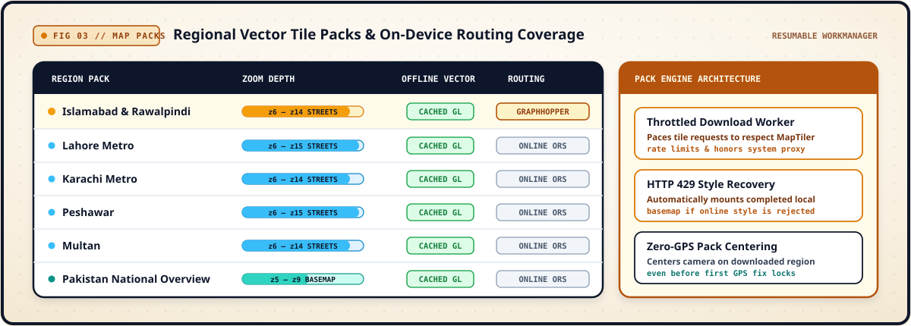
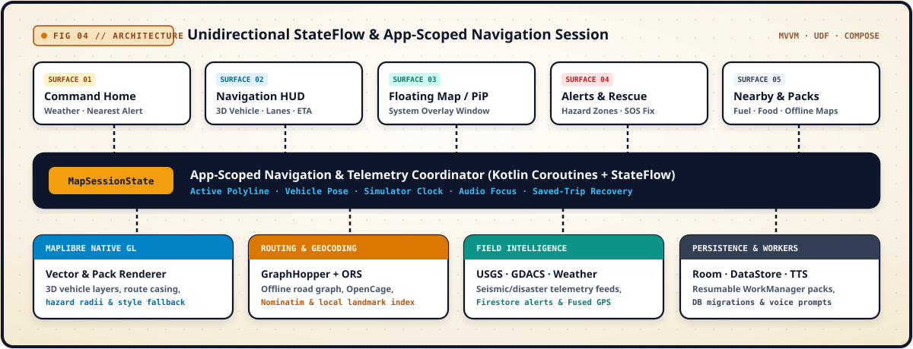

  

<h1 align="center">W.A.F.F.L.E. — Wireless Autonomous Flying Fleet for Life Emergencies</h1>

  <strong>Offline-first Android navigation console and field-awareness station built for zero-connectivity operations.</strong>

  
  &nbsp;
  
  &nbsp;
  

  
  
  
  
  
  

> [!IMPORTANT]
> **Preview 25 (`v1.0.0-preview.25`) is a personal-use preview.** The APK is signed for direct installation. Waffle is free for personal, non-commercial use; commercial use, redistribution, and republication are reserved. See [License](#license--legal).

---

##  &nbsp;Ground Console Interface

**W.A.F.F.L.E.** transforms an Android device into a self-contained field navigation and situational-awareness console—pairing local **MapLibre Native** vector rendering, an embedded **GraphHopper** road-routing engine, 3D vehicle telemetry, and live **USGS / GDACS** disaster feeds.

<table>
  <tr>
    <td align="center" width="25%">
      
        
      <b>Command Home</b>
       
      Nearest seismic/hazard status, local weather, and rapid field actions
    </td>
    <td align="center" width="25%">
      
        
      <b>3D Turn-by-Turn HUD</b>
       
      3D vehicle tracking, voice guidance, route trimming, and live ETA
    </td>
    <td align="center" width="25%">
      
        
      <b>Test Mode Simulator</b>
       
      Variable acceleration, braking, lane hints, and off-route rerouting
    </td>
    <td align="center" width="25%">
      
        
      <b>Zero-Signal Vector Map</b>
       
      Cached regional street tiles with live USGS &amp; GDACS alert radii
    </td>
  </tr>
</table>

---

##  &nbsp;Hybrid Routing &amp; Zero-Signal Failover

When cellular towers drop or map tile servers hit rate limits, Waffle switches seamlessly from cloud APIs to on-device flash storage without blanking the map or dropping an active turn-by-turn session.

  

<table>
  <tr>
    <td width="33%" valign="top">
      <b>Dual-Engine Route Planner</b>
       
      Queries <b>OpenRouteService</b> with alternate routes and road-avoidance filters when online, and falls back to the bundled <b>GraphHopper</b> road graph when disconnected.
    </td>
    <td width="33%" valign="top">
      <b>Off-Route Watchdog</b>
       
      Continuously projects live GPS coordinates onto the active route polyline, triggering an automatic recalculation and Android TTS voice prompt on deviation.
    </td>
    <td width="33%" valign="top">
      <b>Style &amp; Quota Resilience</b>
       
      Monitors MapTiler tile responses and mounts your completed local vector pack automatically if the network drops or returns <code>HTTP 429</code>.
    </td>
  </tr>
</table>

---

##  &nbsp;Multi-Modal 3D Vehicles &amp; Route Simulator

Every travel mode applies its own road-network weights, speed assumptions, camera pitch, and custom 3D map model—backed by a built-in physics simulator (`Test Mode`) for rehearsing routes before heading into the field.

  

---

##  &nbsp;Offline Regional Map Packs

Regional vector packs are managed in the **Offline maps** screen and downloaded in the background via resumable `WorkManager` jobs:

  

---

##  &nbsp;System Architecture

Waffle runs a unidirectional `StateFlow` architecture centered around an application-scoped `MapSessionState` so moving between **Home**, **Map**, **Nearby**, **Alerts**, **Rescue**, or the **Floating Map / PiP** overlay preserves your active navigation and simulation state.

  

---

##  &nbsp;Install Preview 25

  

1. Open the [**Preview 25 Release**](https://github.com/AhmadHasssan9181/Waffle/releases/tag/v1.0.0-preview.25).
2. Download the APK matching your phone (`arm64-v8a` for modern 64-bit devices, `armeabi-v7a` for older 32-bit hardware).
3. Allow installation from your browser or file manager when prompted by Android.
4. Grant **Location** permission for navigation and **Notifications** for background turn-by-turn and offline pack download progress.

---

##  &nbsp;License &amp; Legal

**Free for personal, non-commercial use. All other rights reserved.**

Waffle is free to download and use for personal, non-commercial purposes. Commercial use, redistribution, sublicensing, or publication of modified or unmodified copies is not permitted without prior written permission from the author.

- **License Terms:** [LICENSE](LICENSE)
- **Privacy Policy:** [PRIVACY.md](PRIVACY.md)
- **Third-Party Attributions:** [ATTRIBUTIONS.md](ATTRIBUTIONS.md)

---

  
   
  
    Crafted by <a href="https://github.com/AhmadHasssan9181"><b>Ahmad Hassan</b></a> &nbsp;·&nbsp;
    <a href="https://github.com/AhmadHasssan9181/Waffle/releases">Releases</a> &nbsp;·&nbsp;
    <a href="https://github.com/AhmadHasssan9181/Waffle/issues">Issue Tracker</a>
  

