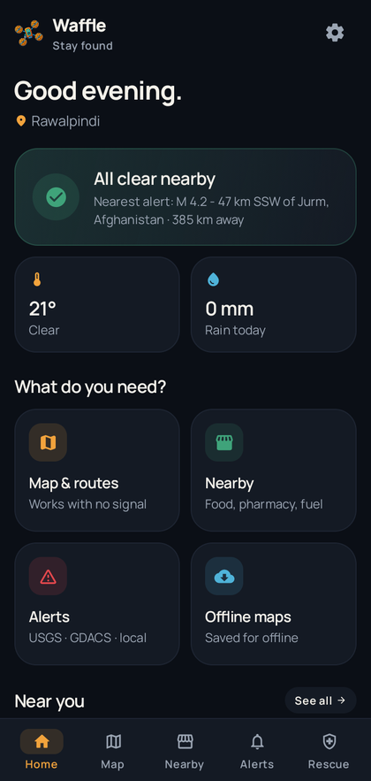
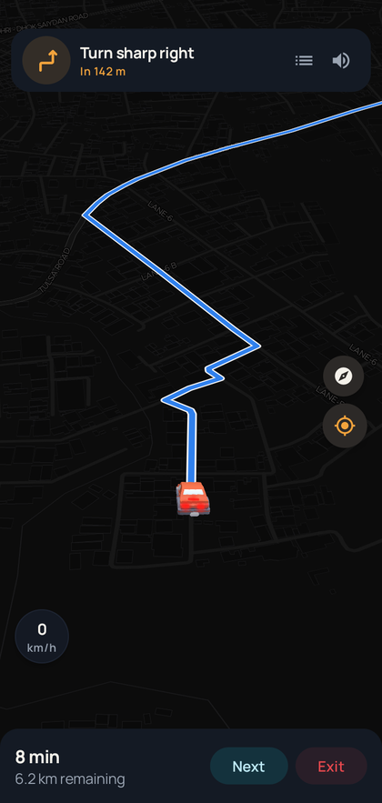
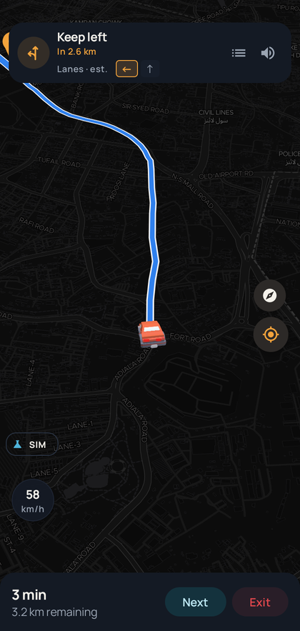
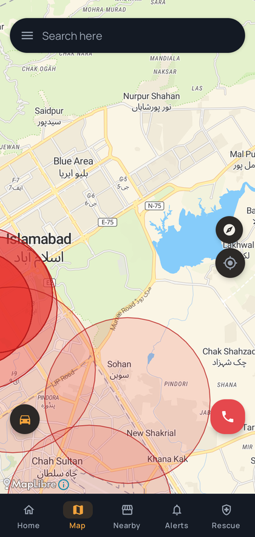
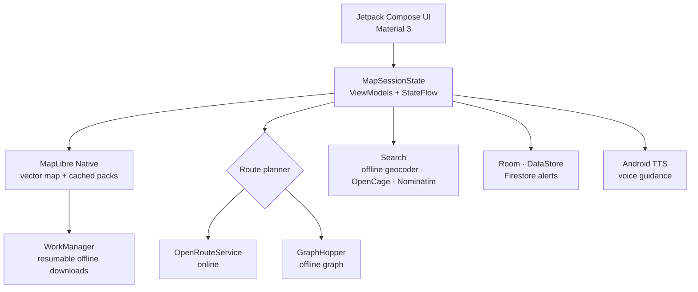

<p align="center">
  
</p>

<h1 align="center">Waffle</h1>

<p align="center">
  <strong>Offline-first navigation for the moments the signal doesn't come back.</strong>
</p>

<p align="center">
  <sub>
    <em>Wireless Autonomous Flying Fleet for Life Emergencies</em> — the name is heritage.<br />
    This build is the ground navigation console.
  </sub>
</p>

<p align="center">
  <a href="https://github.com/AhmadHasssan9181/Waffle/releases/tag/v1.0.0-preview.25">
    
  </a>
  <a href="https://github.com/AhmadHasssan9181/Waffle/issues">
    
  </a>
</p>

<p align="center">
  
  
  
  
  
</p>

> [!IMPORTANT]
> **Preview 25 is a personal-use preview.** The APK is debug-signed and not a Play Store
> release. Waffle is free for personal, non-commercial use; commercial use, redistribution and
> publication are not permitted. See [License](#-license).

---

## ⚡ The short version

Waffle turns an Android phone into a calm, offline-first navigation console: vector maps,
on-device routing, four travel modes, 3D vehicles, voice guidance, cached map packs and a
floating map that survives the trip home.

Built for the reality that maps shouldn't disappear when the signal does.

<table>
  <tr>
    <td align="center" width="25%">
      
      <br /><sub><b>One calm home</b><br />Weather, alerts and nearby essentials.</sub>
    </td>
    <td align="center" width="25%">
      
      <br /><sub><b>Turn-by-turn</b><br />3D vehicles, route progress and live ETA.</sub>
    </td>
    <td align="center" width="25%">
      
      <br /><sub><b>Test Mode</b><br />Variable speed, stops, lane hints and reroutes.</sub>
    </td>
    <td align="center" width="25%">
      
      <br /><sub><b>Still here offline</b><br />Cached streets and hazards, no signal required.</sub>
    </td>
  </tr>
</table>

---

## 🧭 What Waffle does

| Capability | What you get |
| :--- | :--- |
| **Offline-first maps** | MapLibre vector maps with downloadable city packs, cached styles, tiles and labels. A completed pack can open without Wi-Fi or mobile data. |
| **Online + offline routing** | OpenRouteService when connected; the bundled GraphHopper graph when the signal drops. Automatic provider fallback, not a blank screen. |
| **Four real travel modes** | Car, motorcycle, bicycle and walking each get their own routing profile, ETA assumptions and vehicle treatment. |
| **3D vehicle feedback** | Cars, a motorcycle and a walking figure with lights, turn indicators and a camera that stays glued to the route. |
| **Navigation that behaves** | Compact instruction bar, lane hints, voice guidance, arrival logic, alternate routes, avoid options, destination pins and dropped pins. |
| **Test Mode** | Simulate a full trip without moving: crawl, cruise, hard acceleration, braking, full stops, voice prompts and wrong-way rerouting. |
| **Floating map** | A compact map keeps navigating when you leave the app. System PiP is used when the overlay permission is unavailable. |
| **Field awareness** | USGS/GDACS alerts, nearby shops and fuel, weather, hazard overlays and a Rescue screen with fresh coordinates. |
| **A quiet interface** | Dark, warm and deliberately low-chrome. No rainbow dashboards, no shouting at the driver. |

---

## 📴 Offline coverage, honestly

| Area pack | Offline map | Offline routing |
| :--- | :---: | :---: |
| **Islamabad & Rawalpindi** | ✅ z6–14 streets | ✅ GraphHopper graph bundled |
| **Lahore** | ✅ z6–15 streets | — |
| **Karachi** | ✅ z6–14 streets | — |
| **Peshawar** | ✅ z6–15 streets | — |
| **Multan** | ✅ z6–14 streets | — |
| **Pakistan overview** | ✅ z5–9 | — |

Offline routing currently covers **Islamabad–Rawalpindi**. The other packs are for offline
map viewing and are useful for search, orientation and alerts; online routing still works
elsewhere when a connection is available.

MapTiler applies request limits to a network. Waffle throttles offline downloads and can fall
back to a completed cached pack if the online style is rejected. If a download starts returning
HTTP 429, try another network, a VPN, or wait for the limit to reset.

---

## 🛠️ Install Preview 25

<p align="center">
  <a href="https://github.com/AhmadHasssan9181/Waffle/releases/tag/v1.0.0-preview.25">
    
  </a>
</p>

1. Open the [Preview 25 release](https://github.com/AhmadHasssan9181/Waffle/releases/tag/v1.0.0-preview.25).
2. Download the APK that matches your phone (`arm64-v8a` for most modern devices).
3. Allow installation from your browser or file manager if Android asks.
4. Grant location and notification permissions when prompted. Notification permission is only
   needed for navigation and download progress.

The release also includes an **AAB** for store tooling and a **SHA-256** checksum file.

> [!NOTE]
> Preview builds are signed with a debug key so they can be installed directly. A production
> upload key and Play signing are still on the release checklist.

---

## 🧱 Build from source

**Requirements**

- JDK 17 or newer
- Android SDK 36
- Gradle 8.13 (the wrapper is included)

```bash
git clone https://github.com/AhmadHasssan9181/Waffle.git
cd Waffle

./gradlew :app:assembleDebug
./gradlew :app:testDebugUnitTest
```

Build a release bundle:

```bash
./gradlew :app:bundleRelease
```

Provider keys belong in the ignored `local.properties` file, never in Git:

```properties
MAPTILER_API_KEY=...
ORS_API_KEY=...
OPENCAGE_API_KEY=...
```

Keep keys out of commits, screenshots and public logs. For a real deployment, put paid services
behind a backend instead of shipping their secrets in the APK.

---

## 🏗️ Architecture



The map, active route, simulation state and saved trip live in an app-scoped session so moving
between Home, Map and Nearby doesn't throw away a navigation in progress.

---

## 📦 Repository map

```text
Waffle/
├── app/src/main/java/com/noobdev/waffle/
│   ├── core/
│   │   ├── navigation/      # controller, simulator, routing state, TTS focus
│   │   ├── location/        # fresh-location helpers
│   │   ├── network/         # provider clients and map HTTP policy
│   │   └── storage/         # preferences and file state
│   ├── data/
│   │   ├── local/           # Room databases, alerts, saved sessions
│   │   └── remote/          # ORS, OpenCage, weather, alerts
│   ├── feature/
│   │   ├── map/             # map, route preview, navigation HUD, floating map
│   │   ├── offline/         # packs, download worker, style fallback
│   │   ├── alerts/          # disaster feed, filtering, pagination
│   │   ├── shops/           # nearby places and photos
│   │   ├── rescue/          # emergency coordinates
│   │   ├── home/            # dashboard and weather
│   │   └── settings/        # theme, units, vehicle, voice
│   └── design/              # colours, type and shared components
├── assets/                  # README art and screenshots
├── branding/                # Waffle mark, icons, brand notes
├── tools/graph-builder/     # GraphHopper graph preparation
└── LICENSE · ATTRIBUTIONS · PRIVACY
```

---

## 🚦 Status

**Working in Preview 25**

- Offline packs with resumable WorkManager downloads
- Cached-map recovery when an online style fails
- OpenRouteService + GraphHopper routing
- Car, motorcycle, bicycle and walking
- 3D vehicles, turn indicators, route trimming
- Turn-by-turn voice guidance and lane hints
- Test Mode with variable speed and arrival
- Floating map and PiP fallback
- Alerts, nearby shops, weather, Rescue
- Room migrations, saved-trip recovery and pagination

**Next on the list**

- Production upload key and Play signing
- Backend proxy for paid provider keys
- Wider offline routing coverage
- Authoritative `turn:lanes` data
- Traffic incidents and rerouting
- Firebase rules + App Check
- Final Android 14 / process-death device pass

**Not in this build**

- PX4 / MAVLink / DJI flight control
- Autonomous flight
- Gemini-generated incident reports

The Waffle name and drone mark come from the project's original emergency-response
concept. The current preview is a ground navigation app, not an autopilot.

---

## 🔐 Privacy and attribution

- **Privacy notes:** [PRIVACY.md](PRIVACY.md)
- **Third-party notices:** [ATTRIBUTIONS.md](ATTRIBUTIONS.md)
- **Full license text:** [LICENSE](LICENSE)

## 📄 License

### Free for personal use. Everything else reserved.

**Free for personal, non-commercial use. Commercial use, redistribution and publication are not
permitted. All other rights are reserved.** Third-party components remain under their own
licenses listed in [ATTRIBUTIONS.md](ATTRIBUTIONS.md).

If you want to use Waffle commercially or redistribute it, open an issue to ask for written
permission.

---

<p align="center">
  <sub>
    Built with Compose, MapLibre, GraphHopper and an unreasonable amount of attention to
    <em>“does it still work with the Wi-Fi off?”</em>
  </sub>
</p>

<p align="center">
  <a href="https://github.com/AhmadHasssan9181">Ahmad Hassan</a> ·
  <a href="https://github.com/AhmadHasssan9181/Waffle/releases">Releases</a> ·
  <a href="https://github.com/AhmadHasssan9181/Waffle/issues">Issues</a>
</p>
